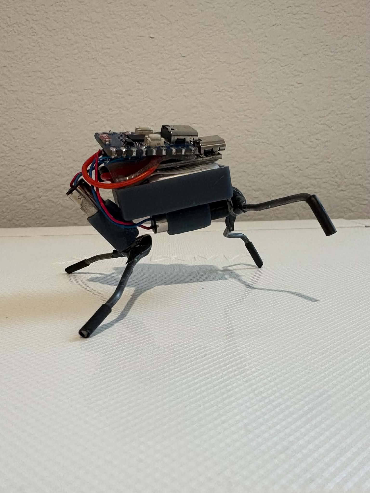
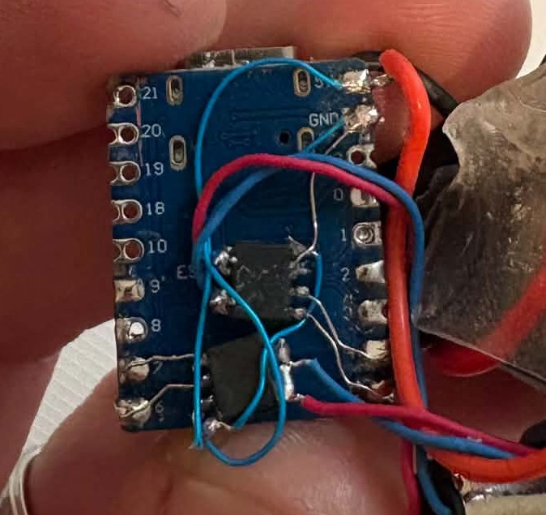
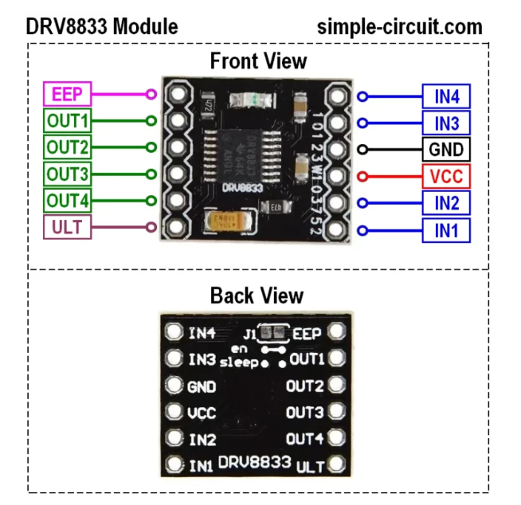
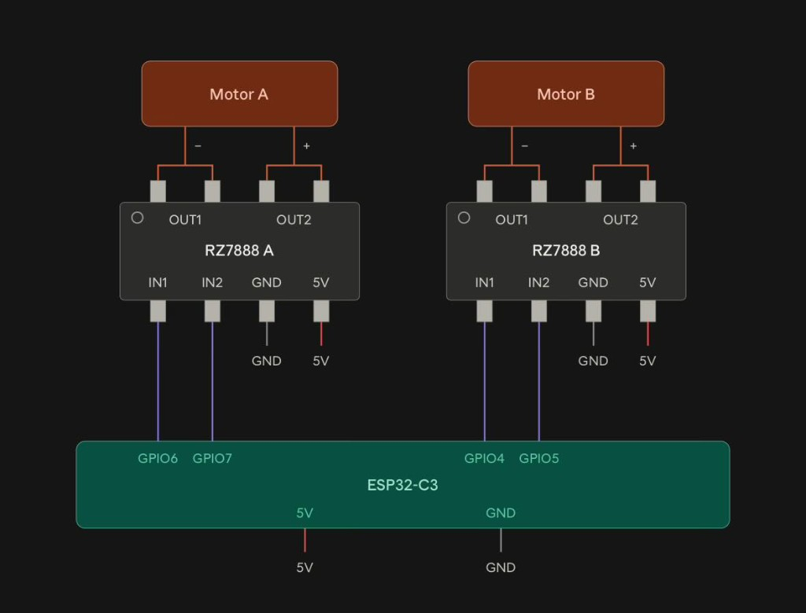

# Micro Crawler: 2 x 6 mm Planetary Gear Motors



A BEAM-style crawler driven by two 6 mm planetary gear motors: one front, one
back. Short full-power strokes alternate diagonally to crawl.

| Folder | Contents |
|---|---|
| `c3_crawler/` | Arduino sketch for an ESP32-C3 driving two DC motors through an H-bridge |
| `stl/` | 3D-printable parts and fit-check reference models |

## Setup

Run once from this folder in PowerShell to install Arduino IDE and the ESP32
board package:

```powershell
powershell -ExecutionPolicy Bypass -File .\setup.ps1             # asks before each install
powershell -ExecutionPolicy Bypass -File .\setup.ps1 -CheckOnly  # only reports what is missing
```

## Motor driver: two options

The crawler shown on Instagram uses a **(messily) freeform-soldered H-bridge made from
two RZ7888 driver chips** (SOP-8), one per motor, soldered point-to-point with
no carrier board.



The **easier method is a DRV8833 board**: one small module drives both motors,
and it needs no SMD soldering. The sketch works unchanged with either driver.



## 3D-printed parts

Print these from `stl/`:

| File | Qty | Notes |
|---|---|---|
| `micro crawler body.stl` | 1 | Main chassis |
| `6mm planetary motor horn v2.stl` | 2 | Motor horn / leg, current version |
| `6mm planetary motor horn.stl` | - | Original horn, superseded by v2 |

Reference models (for fit checks in a slicer or CAD, not for printing):

| File | Represents |
|---|---|
| `front motor.stl`, `rear motor.stl` | 6 mm planetary gear motors in their mounted positions |
| `Arduino ESP32-C3.stl` | ESP32-C3 board |
| `DRV8833.stl` | DRV8833 motor driver board |
| `battery dummy.stl` | 160 mAh LiPo cell |

The meshes are decimated for size; the Blender source stays off the repo.

## Parts

| Part | Note | Link |
|---|---|---|
| 6 mm planetary gear motor (x2) | 46 RPM option | [AliExpress](https://www.aliexpress.us/item/3256812043824069.html) |
| ESP32-C3 Super Mini | | [AliExpress](https://www.aliexpress.us/item/3256807292829704.html) |
| DRV8833 driver board | Easier driver option | [AliExpress](https://www.aliexpress.us/item/3256809648666681.html) |
| RZ7888 driver chip (x2) | Slightly smaller - Harder to solder | https://www.aliexpress.us/item/3256813044482237.html |
| LiPo battery | select "2pcs 160mAh" option | [AliExpress](https://www.aliexpress.us/item/3256812564147983.html) |
| Battery charging circuit | (optional) | https://www.aliexpress.us/item/3256812904123021.html
| Wire hanger for legs |
| JB Weld Epoxy |
| Small heat shrink tubing (optonal) |

## Gait

1. Front motor, direction 1 (front-right foot down)
2. Back motor, direction 1 (back-left foot kicks)
3. Front motor, direction 2 (front-left foot down)
4. Back motor, direction 2 (back-right foot kicks)

Each stroke runs at full duty for a short time, then pauses; consecutive
strokes overlap slightly. The timing is non-blocking.

## Wiring

Each motor takes two PWM inputs (A/B). The ESP32-C3 strapping pins
(GPIO 2, 8, 9) are deliberately unused.

| ESP32-C3 | Sketch name | DRV8833 board | RZ7888 build |
|---|---|---|---|
| GPIO 4 | `FRONT_A` | AIN1 | Front RZ7888, input A |
| GPIO 5 | `FRONT_B` | AIN2 | Front RZ7888, input B |
| GPIO 6 | `BACK_A` | BIN1 | Back RZ7888, input A |
| GPIO 7 | `BACK_B` | BIN2 | Back RZ7888, input B |

- **DRV8833:** front motor to AOUT1/AOUT2, back motor to BOUT1/BOUT2, battery
  to VM, and ground shared with the ESP32-C3. If your board breaks out a
  SLEEP/STBY/EEP pin without an onboard pull-up, tie it high or the outputs
  stay off.
- **RZ7888:** each chip's two outputs go straight to its motor's terminals;
  power each chip from the battery, with ground shared with the ESP32-C3.



If a motor turns the wrong way, swap its two motor wires (or swap its A/B pins
in the sketch).

Requires ESP32 Arduino core 3.x (`ledcAttach` / `ledcWrite` by pin).

## License

MIT. See [LICENSE](LICENSE).
